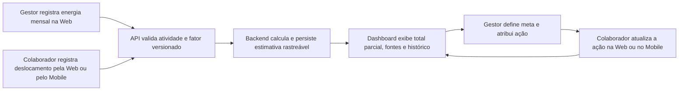

<div align="center">


### Gestão em sintonia.

**Monitoramento e redução da pegada de carbono operacional.**


**🌍 Carbono operacional · ⚡ Energia · 🚲 Mobilidade · 🎯 Metas e ações**

</div>

---

> [!IMPORTANT]
> **Versão do sistema: Acorde 2.0.** Web, API, banco e Mobile estão implementados para o MVP, com validação automatizada de API em PostgreSQL, builds Web/Android e stack Docker local isolado. A demonstração usa apenas fatores sintéticos rotulados no perfil `local-demo`; nenhum fator real ou metodologia foi aprovado. Não houve deploy externo, e validações acadêmicas, de acessibilidade, dispositivos e operação continuam pendentes.

O Acorde é uma plataforma colaborativa para **registrar atividades emissoras, calcular estimativas rastreáveis em kg CO₂e, acompanhar indicadores ambientais e organizar ações de redução**. O MVP prioriza energia elétrica e deslocamentos casa–trabalho. Os cálculos devem informar dados, unidade, fonte, versão e validade do fator utilizado; sem dados suficientes, o registro fica pendente e nenhum impacto é inventado.

## Objetivo e problema

Pequenas e médias organizações podem ter dificuldade para identificar fontes de emissões da rotina de trabalho, acompanhar sua evolução e transformar dados em ações. A necessidade ainda precisa ser validada com uma organização piloto.

**Pergunta-problema:** como auxiliar empresas a identificar, monitorar e reduzir sua pegada de carbono operacional por meio de uma plataforma digital acessível e colaborativa?

O Acorde conecta uma calculadora de carbono, um dashboard ambiental e planos de redução sem se apresentar como inventário corporativo completo. O conceito de **Micro-ESG Operacional** permanece, agora concentrado em carbono.

## Fluxo principal do MVP



O total exibido é parcial e depende da cobertura dos registros. Conclusão de uma ação é indicador operacional; não prova redução de emissões.

## Fontes de emissão

| Prioridade | Dados principais | Classificação conceitual |
|---|---|---|
| Energia elétrica | Consumo em kWh, período e localização/rede aplicável | Escopo 2, eletricidade adquirida |
| Deslocamento casa–trabalho | Modalidade, distância de ida e volta, dias/viagens e ocupação quando pertinente | Escopo 3, categoria 7, para veículos não controlados pela organização |
| Expansões | Frota própria, viagens corporativas, papel, materiais e resíduos | Fora do MVP inicial |

`E = Q × FE`, onde `E` é a emissão estimada em kg CO₂e, `Q` é a quantidade da atividade e `FE` é um fator compatível em unidade e período. Exemplos numéricos do PDF de contexto são fictícios e não devem ser usados como fatores de produção.

## Escopo do MVP — seis semanas

- Autenticação e perfis de gestor/colaborador, com isolamento por organização no backend.
- Gestores registram consumo de energia por período na Web. Colaboradores registram seus deslocamentos pela Web ou pelo Mobile.
- Catálogo de fatores com unidade, fonte, versão, validade, escopo, região e premissas; manter histórico dos fatores usados.
- Cálculo no backend e histórico de registros válidos, pendentes ou substituídos.
- Dashboard Web com emissões monitoradas, cobertura, composição por fonte, evolução e comparação somente entre períodos comparáveis.
- Metas de redução com período-base e prazo, mais ações com responsável, prazo e status.
- Persistência PostgreSQL, validações, tratamento de erros, testes e documentação.

Escopo detalhado e critérios: [`docs/planejamento/escopo-mvp.md`](docs/planejamento/escopo-mvp.md). O plano de seis semanas é uma proposta sujeita à capacidade da equipe e validação acadêmica.

## Requisitos e decisões de escopo

Os requisitos funcionais da versão 2.0 usam a identificação **RF-v2-01 a RF-v2-09**, para não sobrescrever a baseline original RF01–RF11. A correspondência e os itens adiados/retirados estão em [`docs/requisitos/requisitos-funcionais.md`](docs/requisitos/requisitos-funcionais.md). A mudança foi registrada em [`docs/decisoes.md`](docs/decisoes.md), e o relatório está em [`docs/planejamento/relatorio-reformulacao-acorde-2.0.md`](docs/planejamento/relatorio-reformulacao-acorde-2.0.md).

O trabalho de desenvolvimento deve seguir o [`plano de implementação`](docs/planejamento/plano-implementacao.md) e as instruções permanentes em [`AGENTS.md`](AGENTS.md). A Fase 0 prepara decisões e documentação; a Fase 1 cria infraestrutura e banco; decisões de piloto e metodologia continuam pendentes antes das fases de domínio correspondentes.

## Stack e arquitetura preservadas

| Camada | Tecnologia |
|---|---|
| Web | React + TypeScript + Vite |
| Mobile | Flutter (Android/iOS) |
| Backend e API | Java + Spring Boot; REST HTTP/JSON |
| Dados e segurança | PostgreSQL; Spring Security + JWT |
| Organização | Monólito modular, camadas e referência MVC |

Web e Mobile consomem a mesma API. A organização proposta agrupa por domínio (`auth`, `organizacoes`, `carbono`, `fatores`, `metas`, `acoes`, `dashboard`) e mantém Controllers, Services e Repositories dentro de cada módulo.

## Identidade visual e requisitos não funcionais

A identidade visual oficial Acorde permanece: Verde Profundo `#0F3D34`, Verde Médio `#1F6B58`, Menta `#7FD8B0`, Verde Claro `#E8F6F0`, Off-white `#F7FAF8`, Grafite `#1F2A28`, Cinza `#66746D` e Borda `#DDEAE4`. Usar os SVGs e tokens oficiais do Brand Kit; não redesenhar o monograma. Títulos usam Manrope e interfaces usam Inter. Ver [`GUIA_DA_MARCA.md`](assets/branding/Acorde_Brand_Kit/documentacao/GUIA_DA_MARCA.md).

Os RNFs documentados permanecem: desempenho, acessibilidade WCAG/eMAG, responsividade, Android/iOS, Green IT, segurança e LGPD. Senhas devem usar hash apropriado. Ver [`requisitos não funcionais`](docs/requisitos/requisitos-nao-funcionais.md).

## Estrutura do repositório

```text
.
├── README.md
├── AGENTS.md
├── docker-compose.yml
├── backend/                # Spring Boot modular monolith
├── frontend/               # React + TypeScript + Vite
├── mobile/                 # Flutter
├── assets/branding/Acorde_Brand_Kit/
└── docs/
    ├── arquitetura/
    ├── der/
    ├── planejamento/
    ├── prototipos/
    ├── requisitos/
    ├── sprints/
    └── testes/
```

Os diretórios `backend/`, `frontend/` e `mobile/` contêm a fundação técnica, autenticação, motor de carbono, registro de deslocamento, dashboard parcial e gestão operacional de metas/ações da versão 2.0. Há evidência automatizada de API no PostgreSQL e checks de build/lint/analyze; testes visuais em navegador e dispositivo, acessibilidade manual e RNFs continuam pendentes. Nenhum fator real foi aprovado; protótipos e validação de campo também não foram confirmados. Consulte o plano e as evidências antes de considerar uma fase aceita.

## Desenvolvimento local — Fase 1

Pré-requisitos: Git, Java 21, Node.js 24 LTS com npm, Flutter stable e Docker com Docker Compose. Na raiz, crie a configuração local a partir do exemplo e inicie o PostgreSQL:

```powershell
Copy-Item .env.example .env
docker compose up -d postgres
```

Inicie a API (o script carrega `.env` e gera, se necessário, uma chave JWT aleatória local que fica apenas no `.env` ignorado pelo Git; Flyway aplica migrations pendentes):

```powershell
.\backend\run-local.ps1
```

Em outro terminal, inicie o frontend:

```powershell
cd frontend
npm ci
npm run dev
```

O Vite encaminha `/api` para `http://localhost:8080`; configure `VITE_API_PROXY_TARGET` para outra URL se necessário. O health check fica em `http://localhost:8080/api/health`.

Para testar o login em duas organizações isoladas, defina uma senha de demonstração somente no `.env` local (`ACORDE_DEMO_PASSWORD`, 12–72 bytes UTF-8) e execute `.\backend\run-local.ps1 -DemoData`. Esse perfil cria duas organizações e quatro contas fictícias apenas se as tabelas estiverem vazias; não o habilite em produção. A matriz RBAC e os contratos estão em [`docs/api/autenticacao-organizacoes.md`](docs/api/autenticacao-organizacoes.md).

Para analisar/iniciar o Flutter, use `cd mobile`, `flutter pub get`, `flutter analyze`, `flutter test` e `flutter run`. Android Emulator usa `http://10.0.2.2:8080`; iOS Simulator usa `http://localhost:8080`. Em dispositivo físico, informe o endereço local do computador com `--dart-define=ACORDE_API_URL=http://<host>:8080`. HTTP local fica permitido apenas no Android debug e em destinos locais no iOS; ambientes publicados devem usar HTTPS. Web e Mobile mantêm o token apenas em memória e exigem login novamente após expiração/reinício.

`.env.example` contém somente valores locais de desenvolvimento. Não use esses valores em ambientes compartilhados ou de produção. Consulte [`docs/planejamento/plano-implementacao.md`](docs/planejamento/plano-implementacao.md) e [`docs/testes/evidencias-fase-02.md`](docs/testes/evidencias-fase-02.md) para status, testes e limites de validação.

## Referências principais

- [Arquitetura](docs/arquitetura/arquitetura.md)
- [DER da versão 2.0](docs/der/DER_Acorde.md)
- [Validação do problema](docs/planejamento/validacao-problema.md)
- [Cronograma](docs/planejamento/cronograma-6-semanas.md)
- [Protótipos](docs/prototipos/README.md)
- [Plano de testes](docs/testes/plano-testes.md)
- [Relatório final de entrega e checklist](docs/testes/relatorio-final-entrega.md)
- [Decisões](docs/decisoes.md)

---

<div align="center">

### Acorde 2.0

**Gestão em sintonia.**

*Identificar emissões, acompanhar resultados e organizar ações de redução.*

**Projeto acadêmico de Desenvolvimento de Sistemas · SENAI · 2026**

</div>
