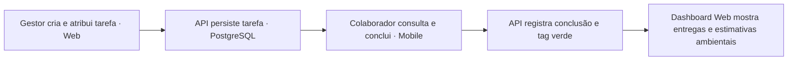
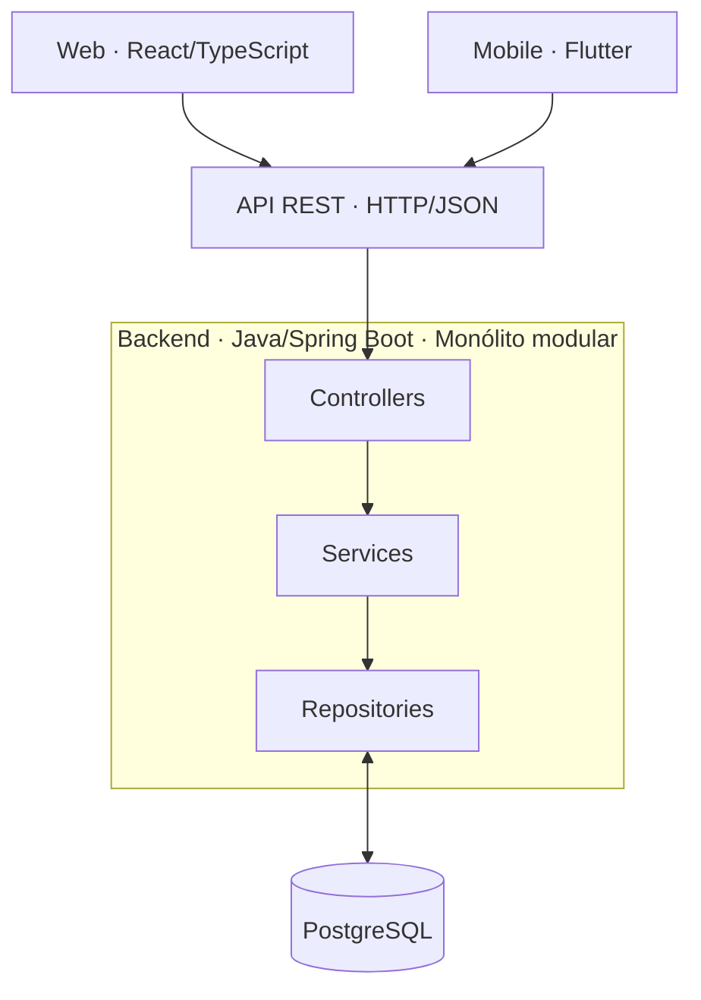

# Plataforma de Gestão Corporativa com Micro-ESG

> **Projeto de Desenvolvimento de Sistemas — Situação de Aprendizagem (6 semanas)**  
> **Status:** planejamento e desenvolvimento inicial · **Nome do produto:** a definir  
> **Plataformas obrigatórias:** Web e Mobile

Uma plataforma colaborativa que conecta **organização do trabalho, acompanhamento de tarefas e sustentabilidade**. Gestores e colaboradores poderão acompanhar responsabilidades e prazos; atividades elegíveis poderão registrar ações sustentáveis com **estimativas transparentes de impacto ambiental**.

O diferencial é o **Micro-ESG Operacional**: trazer indicadores ambientais para dentro da rotina de trabalho, em vez de mantê-los apenas em relatórios separados.

> [!IMPORTANT]
> Este README apresenta a **proposta e o plano de implementação**, não um produto pronto. O escopo para a entrega em seis semanas é um **MVP**, e os 11 requisitos funcionais originais permanecem registrados. Funcionalidades fora do MVP não devem ser apresentadas como implementadas. Ajustes no escopo devem ser alinhados com o professor e registrados em [`docs/decisoes.md`](docs/decisoes.md).

## Sumário

- [Contexto e problema](#contexto-e-problema)
- [Objetivo e proposta de solução](#objetivo-e-proposta-de-solução)
- [Diferencial: Micro-ESG Operacional](#diferencial-micro-esg-operacional)
- [Público e perfis](#público-e-perfis)
- [Escopo do MVP — 6 semanas](#escopo-do-mvp--6-semanas)
- [Requisitos funcionais e prioridades](#requisitos-funcionais-e-prioridades)
- [Requisitos não funcionais](#requisitos-não-funcionais)
- [Tecnologias e arquitetura](#tecnologias-e-arquitetura)
- [Cronograma e entregas](#cronograma-e-entregas)
- [Critério de conclusão de funcionalidades](#critério-de-conclusão-de-funcionalidades)
- [Estrutura do repositório](#estrutura-do-repositório)
- [Fluxo de trabalho no GitHub](#fluxo-de-trabalho-no-github)
- [Protótipos e documentação](#protótipos-e-documentação)
- [Decisões pendentes](#decisões-pendentes)

## Contexto e problema

A dispersão de atividades, prazos e responsabilidades em mensagens, planilhas e canais de comunicação não integrados pode causar **atrasos, retrabalho, falta de visibilidade e sobrecarga**. Ao mesmo tempo, iniciativas de sustentabilidade nem sempre estão conectadas às ações concretas da rotina de uma equipe.

**Problema proposto:** como centralizar a gestão de tarefas de uma equipe e tornar visíveis as contribuições ambientais de suas atividades, sem exigir ferramentas complexas ou processos paralelos?

**Validação de campo pendente:** a situação de aprendizagem exige um problema **real do contexto de estudo, trabalho ou comunidade**. A equipe deverá identificar uma organização ou equipe participante, entrevistar usuários e registrar observações reais em [`docs/planejamento/validacao-problema.md`](docs/planejamento/validacao-problema.md). Não se presume que um cenário hipotético já tenha sido validado.

## Objetivo e proposta de solução

Desenvolver uma solução digital com **aplicação Web + aplicativo Mobile**, integrados à mesma API e banco de dados, para:

1. Centralizar tarefas, responsáveis, estados e prazos.
2. Facilitar o acompanhamento de atividades por gestores e colaboradores.
3. Registrar ações sustentáveis associadas a tarefas e estimar seus efeitos quando houver dados suficientes.
4. Exibir informações operacionais e ambientais de forma compreensível.
5. Evoluir para calendário, metas, alertas, gamificação e controle de carga de trabalho.

### Fluxo principal que o MVP deve demonstrar



A demonstração dessa jornada de ponta a ponta será usada para comprovar a **integração Web/Mobile, o funcionamento da API, a persistência dos dados e o diferencial do projeto**.

## Diferencial: Micro-ESG Operacional

O Micro-ESG associa **tags verdes** às tarefas e reuniões, permitindo que ações sustentáveis contribuam para indicadores e, futuramente, metas da organização.

**Exemplos previstos:** digitalização de documentos, reunião remota e redução de impressões. Para o MVP, o recorte recomendado é **digitalização e economia estimada de papel**, por exigir menos variáveis do que o cálculo de emissões por deslocamento.

> [!NOTE]
> Resultados ambientais devem ser identificados como **estimativas**, com unidade, premissas, dados informados pelo usuário e fonte do fator de cálculo. Concluir uma tarefa **não prova**, por si só, economia de papel ou CO₂. Se não houver dados confiáveis, o sistema deve registrar a ação sem inventar um valor de impacto.

**Evoluções previstas:** metas ESG, Eco-Score, insígnias, sugestões de reuniões remotas e dashboards ambientais mais completos.

## Público e perfis

| Perfil | Funções esperadas |
| --- | --- |
| **Gestor** | Criar e atribuir tarefas, acompanhar atividades da equipe e consultar indicadores. |
| **Colaborador** | Consultar tarefas recebidas e atualizar seu andamento ou conclusão, conforme autorização. |

A matriz detalhada de autorização (RBAC) e o fluxo de aprovação de eventos são pendências da especificação. Toda verificação de permissão deve ser aplicada no **backend**, não apenas na interface.

## Escopo do MVP — 6 semanas

O **MVP (Produto Mínimo Viável)** foi proposto para priorizar um produto **funcional, integrado, testável e demonstrável** no prazo da atividade.

### Entregas essenciais do MVP

| Área | Resultado mínimo esperado | Plataforma |
| --- | --- | --- |
| Acesso | Login com perfis Gestor e Colaborador e controle básico de autorização | API + Web + Mobile |
| Tarefas | Criar, listar, editar, atribuir e concluir tarefas; registrar responsáveis e prazos | API + Web |
| Acompanhamento móvel | Login, visualização de tarefas atribuídas e atualização de conclusão | Mobile + API |
| Micro-ESG | Associar tag verde a tarefa elegível e registrar dados para estimativa simples de papel | API + ao menos uma interface |
| Dashboard | Exibir tarefas concluídas/pendentes e resumo dos impactos ambientais estimados | Web + API |
| Qualidade | Persistência no PostgreSQL, validações, tratamento de erros, testes e documentação | Projeto completo |

**Prioridade técnica:** conseguir primeiro a jornada completa **Web → API → Banco → Mobile → API → Dashboard**; só depois ampliar a quantidade de telas e funcionalidades.

### Escopo complementar, sujeito ao andamento

Calendário básico, mural de lembretes, metas ambientais, indicador de carga de trabalho e alerta simples de tarefas similares. Essas funcionalidades são candidatas à **segunda etapa**, mas não devem colocar em risco a integração e a estabilidade do MVP.

### Expansão após o MVP

Notificações push em tempo real, aprovações complexas de agendamentos, gamificação completa, comparação semântica avançada de tarefas e relatórios ESG aprofundados.

> **Governança de escopo:** a divisão MVP/complementar/expansão é uma **proposta de priorização da equipe**. Ela não apaga requisitos da especificação original, e deve ser validada com a orientação do projeto caso seja necessário alterar a entrega exigida.

Mais detalhes: [`docs/planejamento/escopo-mvp.md`](docs/planejamento/escopo-mvp.md).

## Requisitos funcionais e prioridades

A documentação original define **RF01–RF11**. A coluna *Priorização proposta* distingue a especificação completa do recorte de desenvolvimento em seis semanas.

| Código | Requisito original | Priorização proposta |
| --- | --- | --- |
| **RF01** | Calendário corporativo inteligente (dia/semana/mês, eventos, sugestões remotas) | Complementar |
| **RF02** | Mural de lembretes e post-its | Complementar |
| **RF03** | Notificações e alertas em tempo real no navegador/app | Expansão |
| **RF04** | Agendamentos gerais gerenciados por gestores, com controle de aprovação para colaboradores | Expansão |
| **RF05** | Cadastro de tarefas e verificação de duplicidades | **MVP:** gestão de tarefas; **complementar:** anti-duplicidade |
| **RF06** | Tags verdes e estimativas ambientais em tarefas/reuniões | **MVP:** tarefa + papel; **complementar:** reuniões/CO₂ |
| **RF07** | Metas de sustentabilidade e acompanhamento gráfico | Complementar |
| **RF08** | Eco-Score, pontuações e conquistas | Expansão |
| **RF09** | Indicador de carga de trabalho com alerta de sobrecarga | Complementar |
| **RF10** | Dashboards de produtividade e ESG | **MVP:** indicadores básicos; **complementar:** relatórios avançados |
| **RF11** | Autenticação por e-mail/senha com perfis Gestor/Colaborador | MVP |

A implementação do CRUD ampliado de tarefas deriva da necessidade operacional descrita na arquitetura e no planejamento; o RF05 original deve continuar documentado na sua redação completa.

### Regra especificada para carga de trabalho (RF09)

```text
U = (He / Hc) × 100

He = soma das horas estimadas atribuídas ao colaborador no período
Hc = capacidade horária disponível no mesmo período
U  = taxa de utilização (%)
```

Faixas originais: **verde até 85%**, **amarelo de 86% a 99%** e **vermelho a partir de 100%**. Antes de implementar, a equipe precisa definir como lidar com valores decimais, indisponibilidade e `Hc = 0`.

## Requisitos não funcionais

| Código | Compromisso documentado |
| --- | --- |
| **RNF01 — Desempenho** | Confirmação visual de criação, edição e consulta de tarefas/eventos em até **5 segundos**. |
| **RNF02 — Acessibilidade** | Alinhamento às **WCAG 2.1/2.2 (A e AA)** e ao **eMAG**; teclado, leitores de tela e contraste. |
| **RNF03 — Usabilidade** | Interface intuitiva, responsiva e com boas práticas de UI/UX. |
| **RNF04 — Multiplataforma** | Aplicação Web e aplicativo Mobile com objetivo de compatibilidade **Android/iOS**. |
| **RNF05 — Green IT** | Modo escuro e código/consultas otimizados para reduzir processamento e transferência de dados. |
| **RNF06 — Segurança e privacidade** | Autenticação, controle de acesso, proteção de dados e cuidados com a LGPD. |

No backend, senhas devem ser protegidas por **hash seguro para senhas** (ex.: BCrypt/Argon2id), não por criptografia reversível. Requisitos de acessibilidade e tratamento de erros devem ser considerados desde a primeira tela, não apenas na última semana.

## Tecnologias e arquitetura

| Camada | Tecnologia definida |
| --- | --- |
| Web | **React + TypeScript + Vite** |
| Mobile | **Flutter** |
| Backend | **Java + Spring Boot** |
| API | **REST, HTTP/JSON** |
| Dados | **PostgreSQL** |
| Segurança | **Spring Security + JWT** |
| Versionamento | **Git + GitHub** |

**Arquitetura definida:** monólito modular, arquitetura em camadas e referência ao padrão MVC. Web e Mobile consomem a **mesma API REST**, concentrando as regras de negócio no backend.



No backend, a organização por **módulo de negócio**, com Controllers, Services e Repositories internos a cada módulo, é recomendada para concretizar o monólito modular. Os módulos iniciais serão **autenticação, usuários, tarefas, Micro-ESG e dashboard**; os demais poderão ser adicionados conforme as entregas.

Documentação técnica original: [`docs/arquitetura/arquitetura.md`](docs/arquitetura/arquitetura.md).

## Cronograma e entregas

O trabalho possui **seis semanas** de duração. A organização abaixo segue as atividades e entregas da situação de aprendizagem.

| Semana | Etapa | Principal entrega/evidência |
| --- | --- | --- |
| **1** | Planejamento e pesquisa | Problema contextualizado, requisitos iniciais, wireframes, divisão de responsabilidades e planejamento. |
| **2** | Sprint 1 — Design e fundação | Arquitetura, repositório e ambiente configurados, navegação inicial Web/Mobile e primeiras funcionalidades. |
| **3** | Sprint 2 — Implementação | CRUD de tarefas e API/banco integrados; fluxo Mobile consumindo dados reais. |
| **4** | Sprint 2 — Integração e qualidade | MVP integrado, Micro-ESG básico, dashboard, testes iniciais e evidências de execução. |
| **5** | Sprint 3 — Testes e documentação | Projeto estabilizado, testes finais, diagramas, documentação da API, manual e apresentação preparada. |
| **6** | Apresentação | Demonstração funcional e apresentação de **até 15 minutos**, com participação da equipe. |

As avaliações incluem **clareza do problema, requisitos, protótipos, arquitetura aplicada, colaboração, implementação real, integração com banco/API, testes, consistência, desempenho, tratamento de erros e documentação**. Não basta apresentar telas estáticas.

Consultar: [`docs/planejamento/cronograma-6-semanas.md`](docs/planejamento/cronograma-6-semanas.md).

## Critério de conclusão de funcionalidades

Uma issue só deve ser considerada **Concluída** quando os itens aplicáveis abaixo forem atendidos:

- [ ] Está vinculada a um requisito (RF/RNF) ou a uma tarefa técnica identificada.
- [ ] Possui critérios de aceitação objetivos e demonstra um fluxo de usuário real.
- [ ] A interface relevante está conectada à API; nenhum dado simulado é apresentado como integração real.
- [ ] Dados necessários são persistidos e recuperados corretamente pelo PostgreSQL.
- [ ] Autenticação, autorização, validações e tratamento de erros relevantes estão funcionando.
- [ ] Há testes executados e **evidências** registradas (passos, resultados, prints ou logs sem segredos).
- [ ] A documentação está atualizada e um pull request foi revisado antes da integração.

**Observação:** nem toda issue envolve as duas interfaces ou o banco; os critérios devem ser aplicados conforme a natureza da entrega, sem dispensar validação técnica.

## Estrutura do repositório

Este projeto é organizado como **monorepositório**, reunindo documentação e, quando iniciados, três projetos de código.

```text
.
├── README.md
├── CONTRIBUTING.md
├── .gitignore
├── .github/
│   ├── ISSUE_TEMPLATE/
│   │   ├── funcionalidade.md
│   │   └── bug.md
│   └── PULL_REQUEST_TEMPLATE.md
├── docs/
│   ├── decisoes.md
│   ├── planejamento/
│   │   ├── cronograma-6-semanas.md
│   │   ├── escopo-mvp.md
│   │   └── validacao-problema.md
│   ├── requisitos/
│   │   ├── requisitos-funcionais.md
│   │   └── requisitos-nao-funcionais.md
│   ├── arquitetura/
│   │   └── arquitetura.md
│   ├── prototipos/
│   │   └── README.md
│   ├── sprints/
│   │   └── README.md
│   └── testes/
│       └── plano-testes.md
├── assets/                       # Criar ao definir a identidade visual
├── backend/                      # Criar ao inicializar o Spring Boot
├── frontend/                     # Criar ao inicializar React/Vite
└── mobile/                       # Criar ao inicializar Flutter
```

Os diretórios de código e `assets/` exibidos acima são **planejados**, não necessários para a configuração inicial. O Git não versiona pastas vazias. Os documentos e templates da estrutura inicial estão incluídos no pacote deste repositório.

## Fluxo de trabalho no GitHub

**Uma issue por funcionalidade/entrega**, com responsável, requisito relacionado, sprint e critérios de aceitação. Organizar no **GitHub Projects**: `Backlog` → `A fazer` → `Em desenvolvimento` → `Em revisão` → `Concluído`.

**Marcos sugeridos:** `Semana 1 — Planejamento`, `Semana 2 — Fundação`, `Semana 3–4 — MVP`, `Semana 5 — Qualidade`, `Semana 6 — Apresentação`.

**Labels sugeridas:** `tipo:feature`, `tipo:bug`, `tipo:docs`, `area:backend`, `area:web`, `area:mobile`, `area:esg`, `prioridade:alta`, `RF05`, `RF06`, `RF10`, `RF11` (estender conforme necessário).

**Branches:** `main` como referência estável e branches como `feat/login`, `feat/tarefas-api`, `feat/mobile-tarefas`, `docs/der`. Alterações são integradas por **pull requests**, preferencialmente com revisão de outro integrante.

É importante manter **registro de autoria**, divisão de tarefas e evidências por sprint, pois o projeto inclui critérios de colaboração e participação individual. Orientações em [`CONTRIBUTING.md`](CONTRIBUTING.md) e [`docs/sprints/README.md`](docs/sprints/README.md).

## Protótipos e documentação

Os documentos do projeto já registram referências a **protótipos Web e Mobile no Google Stitch** e um **quadro Trello**. Os links devem ser adicionados apenas após confirmar sua visibilidade e permissões; **links de convite privados não devem ser publicados**.

Para apresentar os fluxos do usuário, consultar [`docs/prototipos/README.md`](docs/prototipos/README.md). A validação dos protótipos existentes e sua correspondência com o recorte do MVP ainda são atividades pendentes.

## Decisões pendentes

- [ ] Definir nome, público-piloto e contexto real da aplicação.
- [ ] Validar prioridades do MVP com o professor e registrar eventuais mudanças.
- [ ] Nomear responsáveis e distribuir as tarefas por integrante.
- [ ] Escolher se o sistema atende uma única empresa ou várias organizações.
- [ ] Modelar entidades, DER, estados de tarefa e contratos da API.
- [ ] Formalizar matriz RBAC, regras de atribuição e acesso aos dados.
- [ ] Definir metodologia e dados mínimos para estimativas ambientais, sem exagerar benefícios.
- [ ] Definir estratégia de testes, medições de desempenho e ambiente de demonstração.
- [ ] Decidir hospedagem, publicação e licenciamento do repositório.

As decisões devem ser documentadas em [`docs/decisoes.md`](docs/decisoes.md), com data e justificativa.

---

**Projeto acadêmico de Desenvolvimento de Sistemas** · Aplicações Web e Mobile · Gestão operacional + Micro-ESG.
