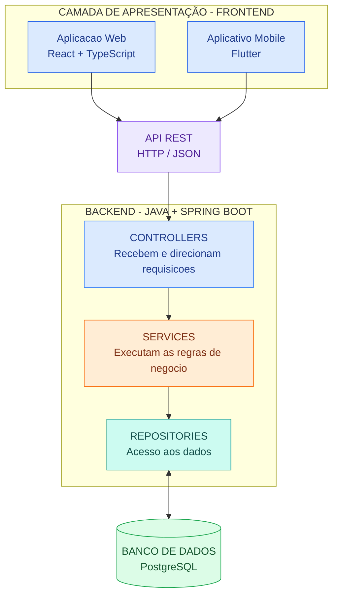

# Definição da arquitetura do sistema

## 1. Arquitetura escolhida

Para o desenvolvimento do sistema, será adotada uma **arquitetura em camadas (Layered Architecture), combinada com o padrão MVC (Model-View-Controller), comunicação por meio de uma API REST e organização interna em monólito modular**.

Essa arquitetura foi escolhida para separar as responsabilidades do sistema, facilitar a manutenção do código, permitir a evolução das funcionalidades e reduzir o acoplamento entre os componentes.

A aplicação será organizada em quatro camadas principais:

- **Camada de apresentação:** responsável pelas interfaces utilizadas pelos gestores e colaboradores.
- **Camada de controle:** responsável por receber as requisições, realizar validações iniciais e direcionar as operações.
- **Camada de negócio:** responsável por executar as regras e os processos fundamentais do sistema.
- **Camada de acesso a dados:** responsável pela comunicação com o banco de dados e pelo gerenciamento das informações armazenadas.

A aplicação contará com interfaces Web e Mobile, que compartilharão o mesmo backend e utilizarão uma API REST para comunicação, por meio de requisições HTTP e troca de dados no formato JSON.

## 2. Visão geral da arquitetura

O diagrama a seguir apresenta o fluxo principal de comunicação entre as interfaces, a API REST, as camadas do backend e o banco de dados.



## 3. Camada de apresentação (View)

A camada de apresentação será responsável pela interação entre os usuários e o sistema, disponibilizando as funcionalidades por meio de interfaces intuitivas, responsivas e acessíveis.

O projeto contará com duas aplicações:

- **Frontend Web:** desenvolvido utilizando React com TypeScript, responsável pela interface acessada por navegadores, incluindo dashboards, gerenciamento de tarefas, calendário, notificações e acompanhamento de indicadores.
- **Aplicativo Mobile:** desenvolvido utilizando Flutter, disponibilizando as principais funcionalidades do sistema para dispositivos Android e iOS.

As interfaces serão responsáveis por apresentar as informações, receber os dados fornecidos pelos usuários e enviar as solicitações ao backend por meio da API REST.

## 4. Camada de controle (Controller)

A camada de controle será responsável por receber e processar as requisições enviadas pelas interfaces Web e Mobile.

Suas principais responsabilidades serão:

- Receber requisições HTTP enviadas pelos clientes;
- Realizar validações iniciais dos dados recebidos;
- Verificar autenticação e permissões de acesso;
- Encaminhar as operações para os serviços responsáveis;
- Retornar respostas adequadas às interfaces, incluindo dados ou mensagens de erro.

Por exemplo, quando um colaborador cadastrar uma nova tarefa, o controlador receberá as informações enviadas pelo formulário e encaminhará a solicitação ao serviço responsável pelo gerenciamento de tarefas.

## 5. Camada de negócio (Service)

A camada de negócio concentrará as regras e os processos fundamentais da aplicação, sendo responsável por determinar como cada funcionalidade deverá operar.

Para facilitar a organização e a manutenção, essa camada será dividida em serviços especializados:

| Serviço | Responsabilidade |
|---|---|
| AuthService | Autenticação de usuários e gerenciamento de acesso. |
| UsuarioService | Cadastro, edição e gerenciamento de usuários e perfis. |
| TarefaService | Criação, edição, atribuição e conclusão de tarefas. |
| CalendarioService | Gerenciamento de eventos, reuniões e compromissos. |
| NotificacaoService | Geração e gerenciamento de notificações e lembretes. |
| MicroEsgService | Estimativa e acompanhamento dos impactos ambientais das atividades. |
| MetaEsgService | Cadastro e acompanhamento de metas de sustentabilidade. |
| GamificacaoService | Gerenciamento de pontuações, medalhas e conquistas. |
| CargaTrabalhoService | Cálculo da ocupação dos colaboradores e identificação de sobrecargas. |
| DashboardService | Consolidação de indicadores operacionais e ambientais. |

Essa divisão permite que cada serviço tenha uma responsabilidade específica, facilitando a implementação de novas funcionalidades e a realização de alterações sem comprometer o funcionamento de outras partes do sistema.

## 6. Camada de acesso a dados (Repository / Model)

A camada de acesso a dados será responsável pela comunicação entre a aplicação e o banco de dados PostgreSQL.

Será utilizado o padrão Repository para organizar as operações de persistência, evitando que os serviços de negócio precisem lidar diretamente com consultas SQL ou detalhes de armazenamento.

Suas principais responsabilidades serão:

- Cadastrar e consultar usuários;
- Armazenar e recuperar tarefas e compromissos;
- Atualizar o andamento das atividades;
- Registrar metas e indicadores de sustentabilidade;
- Armazenar pontuações e conquistas;
- Recuperar informações necessárias para os dashboards.

Os Models representarão as principais entidades e estruturas de dados utilizadas pela aplicação, como usuários, tarefas, eventos e metas ESG.

## 7. Aplicação do padrão MVC

O padrão MVC (Model-View-Controller) será utilizado como referência para organizar os componentes responsáveis pela apresentação, representação dos dados e processamento das requisições.

| Elemento | Função no sistema | Exemplo |
|---|---|---|
| Model | Representa as entidades e estruturas de dados. | Usuário, Tarefa, Evento e Meta ESG. |
| View | Apresenta as informações e permite a interação com o usuário. | Dashboard, calendário e formulários. |
| Controller | Recebe e direciona as requisições. | TarefaController e UsuarioController. |

No backend, essa organização será aplicada diretamente por meio dos Controllers, Models e demais componentes da aplicação. No frontend React, a camada de apresentação será estruturada com componentes reutilizáveis, páginas e elementos de interface.

### Exemplo prático: cadastro de uma tarefa

1. O colaborador acessa a interface Web ou Mobile e preenche o formulário de cadastro de tarefa.
2. A interface envia os dados para o endpoint correspondente da API REST.
3. O Controller recebe a requisição e realiza as validações iniciais.
4. O TarefaService executa as regras de negócio, verificando permissões, informações obrigatórias e possíveis duplicidades.
5. O serviço utiliza o TarefaRepository para armazenar os dados no PostgreSQL.
6. O backend retorna uma resposta à interface, que atualiza a lista de tarefas e apresenta uma confirmação ao usuário.

Esse fluxo mantém as responsabilidades separadas e permite que as diferentes interfaces utilizem as mesmas regras de negócio.

## 8. Organização modular do sistema

Além da separação em camadas, o sistema será dividido em módulos funcionais, de acordo com as principais áreas de atuação da aplicação.

| Módulo | Principais funcionalidades |
|---|---|
| Usuários e permissões | Login, cadastro, gerenciamento de perfis e níveis de acesso. |
| Gestão de tarefas | Criação, edição, atribuição, definição de prazos e conclusão de atividades. |
| Calendário | Organização de eventos, reuniões e compromissos. |
| Notificações | Alertas, lembretes e avisos automáticos. |
| Micro-ESG | Registro e estimativa de impactos ambientais associados às atividades. |
| Metas ESG | Definição, acompanhamento e visualização de objetivos sustentáveis. |
| Gamificação | Eco-Score, medalhas, conquistas e recompensas. |
| Carga de trabalho | Cálculo da ocupação dos colaboradores e alertas de sobrecarga. |
| Dashboard | Visualização integrada de indicadores operacionais e ambientais. |

Essa organização permitirá que os módulos sejam desenvolvidos e mantidos de maneira estruturada, respeitando suas responsabilidades e mantendo a integração entre as funcionalidades.

## 9. Estrutura de pastas sugerida

O backend será organizado de acordo com a arquitetura em camadas, mantendo os arquivos agrupados por responsabilidade.

```text
backend/
└── src/
    ├── controllers/
    │   ├── AuthController.java
    │   ├── TarefaController.java
    │   ├── CalendarioController.java
    │   └── MicroEsgController.java
    │
    ├── services/
    │   ├── AuthService.java
    │   ├── UsuarioService.java
    │   ├── TarefaService.java
    │   ├── CalendarioService.java
    │   ├── MicroEsgService.java
    │   ├── GamificacaoService.java
    │   └── DashboardService.java
    │
    ├── repositories/
    │   ├── UsuarioRepository.java
    │   ├── TarefaRepository.java
    │   └── EventoRepository.java
    │
    ├── models/
    │   ├── Usuario.java
    │   ├── Tarefa.java
    │   ├── Evento.java
    │   └── MetaEsg.java
    │
    ├── dtos/
    ├── middleware/
    ├── config/
    └── ...
```

O frontend Web e o aplicativo Mobile possuirão estruturas próprias, organizadas de acordo com suas respectivas tecnologias, consumindo os mesmos endpoints disponibilizados pelo backend.

## 10. Tecnologias e ferramentas previstas

| Componente | Tecnologia | Finalidade |
|---|---|---|
| Frontend Web | React + TypeScript | Desenvolvimento da interface Web. |
| Ferramenta de build | Vite | Inicialização e compilação do frontend Web. |
| Frontend Mobile | Flutter | Desenvolvimento do aplicativo Android e iOS. |
| Backend | Java + Spring Boot | Implementação da API REST e das regras de negócio. |
| Comunicação | API REST (HTTP/JSON) | Integração entre frontend e backend. |
| Banco de dados | PostgreSQL | Armazenamento e gerenciamento das informações. |
| Autenticação | Spring Security + JWT | Autenticação e controle de acesso. |
| Versionamento | Git + GitHub | Controle de versões e colaboração no desenvolvimento. |

## 11. Definição do modelo de implantação

O backend será desenvolvido utilizando o modelo de **monólito modular**, no qual todos os módulos funcionais serão mantidos em uma única aplicação, mas organizados internamente de maneira independente.

Essa abordagem foi escolhida por apresentar menor complexidade de desenvolvimento e implantação em comparação com uma arquitetura baseada em microsserviços, sendo mais adequada ao escopo e às necessidades atuais do projeto.

Entre suas principais vantagens estão:

- **Menor complexidade:** não exige a configuração e manutenção de diversos serviços independentes.
- **Facilidade de desenvolvimento:** permite concentrar a implementação e os testes em uma única aplicação backend.
- **Organização:** mantém as funcionalidades separadas em módulos com responsabilidades específicas.
- **Possibilidade de expansão:** permite que módulos sejam separados futuramente, caso exista necessidade de escalabilidade independente.

## 12. Justificativa da escolha arquitetural

A arquitetura em camadas, combinada com o padrão MVC, a comunicação por API REST e a organização em monólito modular, foi escolhida por oferecer uma estrutura organizada, flexível e adequada às necessidades do sistema.

A separação entre apresentação, controle, negócio e acesso a dados facilita a manutenção, reduz o acoplamento e permite que diferentes interfaces utilizem as mesmas regras de negócio.

A utilização de React com TypeScript no frontend Web e Flutter no aplicativo Mobile possibilita oferecer experiências específicas para cada plataforma, enquanto o backend desenvolvido em Java com Spring Boot centraliza o processamento das informações e a execução das regras do sistema.

Dessa forma, a arquitetura proposta atende aos requisitos funcionais e não funcionais identificados, permitindo o desenvolvimento das funcionalidades de gestão operacional, sustentabilidade e acompanhamento gerencial, além de possibilitar futuras expansões.