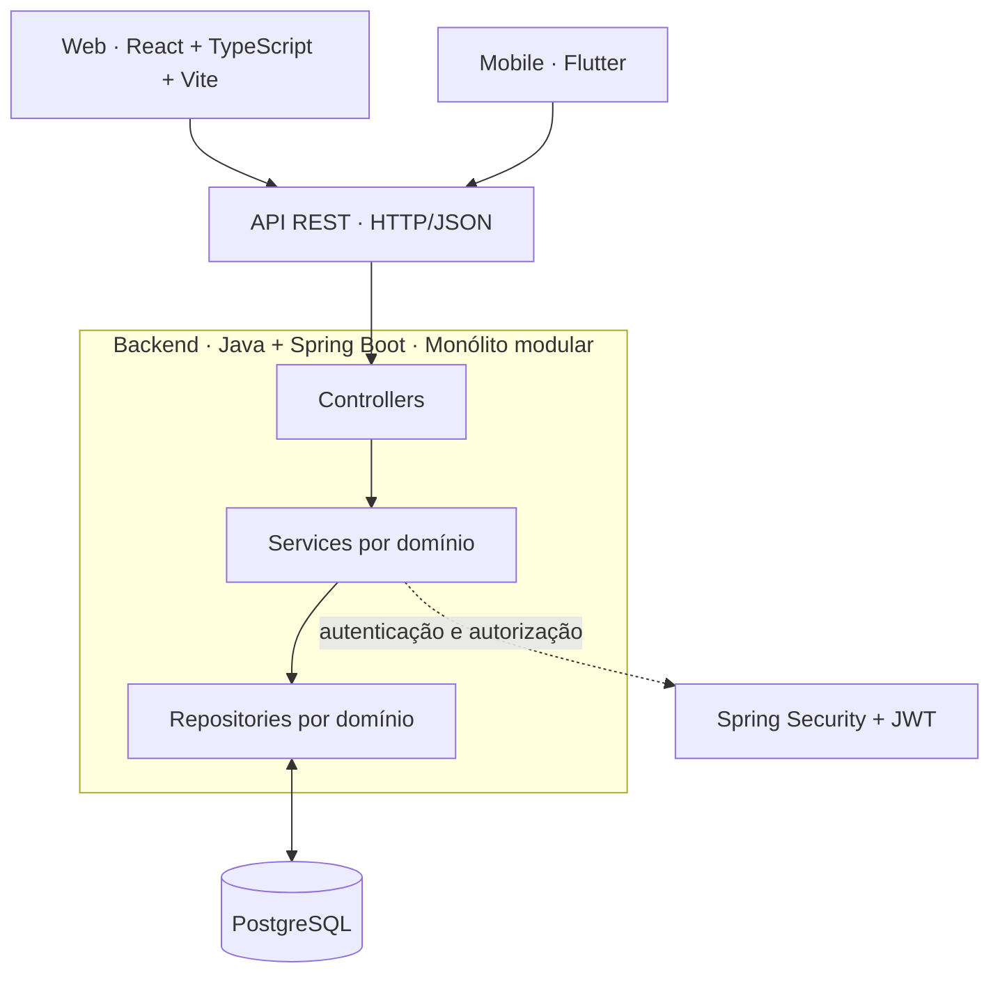

# Arquitetura do sistema — Acorde 2.0

> **Versão do sistema: 2.0.** A Fase 1 preparou a base técnica; a Fase 2 implementa autenticação, organizações e membros. Módulos de carbono, fatores, cálculos, metas, ações e dashboard permanecem por implementar. Stack e decisões arquiteturais gerais são preservadas.

## 1. Decisões preservadas

- Web: React + TypeScript + Vite.
- Mobile: Flutter, com objetivo Android/iOS.
- Backend: Java + Spring Boot; API REST HTTP/JSON.
- Dados: PostgreSQL; segurança: Spring Security + JWT.
- Arquitetura: monólito modular, camadas e referência MVC.
- Versionamento: Git + GitHub.

Web e Mobile consomem a mesma API. Autenticação, autorização por organização, validação, cálculo e agregação ficam no backend.

## 2. Visão geral



## 3. Organização do backend

Para concretizar o monólito modular, organizar primeiro por domínio e manter as camadas internas a cada módulo. Isso resolve a divergência da documentação anterior, que descrevia módulos de negócio mas ilustrava uma árvore agrupada apenas por camada.

| Módulo proposto | Responsabilidades |
|---|---|
| `auth` | Login, emissão/validação de JWT e contexto autenticado |
| `organizacoes` | Usuários, membros, papéis e isolamento organizacional |
| `carbono` | Registro e validação de atividades emissoras e dados por fonte |
| `fatores` | Catálogo de fatores versionados, validade e compatibilidade |
| `calculos` | Aplicar fator, persistir revisão e definir estado vigente/pendente |
| `metas` | Períodos-base, metas de redução e progresso comparável |
| `acoes` | Ações de redução, responsáveis, prazo e estado |
| `dashboard` | Consultas e agregações; sem armazenar totais duplicados |

Cada módulo pode conter `controller`, `service`, `repository`, `entity/model`, `dto` e validações conforme necessário. Evitar dependência circular. O dashboard consulta registros válidos vigentes; não deve manter uma cópia de total que possa divergir da origem.

## 4. Responsabilidades por camada

### Apresentação

- **Web:** gestor registra energia, consulta histórico/dashboard, define metas e atribui ações.
- **Mobile:** colaborador registra deslocamento, consulta seus registros/metas e atualiza ações autorizadas.
- Interfaces exibem estados pendentes, dados faltantes, unidades e limites dos indicadores.
- A identidade usa os tokens/logotipos oficiais do Brand Kit; a paleta funcional de erro/alerta/sucesso permanece distinta da paleta de marca.

### Controllers / API

Receber requisições HTTP, validar formato/DTO, invocar serviços e devolver contratos JSON e erros consistentes. Controllers não calculam emissões nem substituem verificações de autorização.

### Services

Aplicar regras de negócio: isolamento de organização, RBAC, compatibilidade de unidade/categoria/período/região, versionamento do cálculo, validade temporal de fator, metas comparáveis e transições autorizadas de ação.

### Repositories / PostgreSQL

Persistir organizações, membros, atividades, detalhes de fonte, fatores versionados, revisões de cálculo, metas e ações. Usar DECIMAL/NUMERIC para quantidades, fatores e resultados. UUID e constraints são a proposta inicial, sujeita à revisão do DER.

## 5. Fluxo de cálculo

1. Interface envia a atividade e unidade, período e atributos obrigatórios da fonte.
2. API autentica usuário; serviço verifica papel e vínculo organizacional.
3. Serviço valida atividade e encontra fator aplicável à categoria, unidade, período e região.
4. Se houver informação insuficiente ou nenhum fator compatível, persistir estado pendente e motivo; não gerar zero.
5. Se houver compatibilidade, calcular `E = Q × FE`, registrar quantidade, unidade, fator, versão, fonte, premissas e resultado.
6. Revisões ficam no histórico; somente uma revisão válida vigente por atividade entra nas agregações, evitando dupla contagem.
7. Dashboard agrega somente registros vigentes e informa cobertura/limitações.

A forma de versionar fator/cálculo e a unicidade de uma versão vigente precisam ser formalizadas em migrações e testes. Alterações de fator nunca devem reescrever resultado histórico de forma silenciosa.

## 6. Segurança, privacidade e consistência

- Spring Security + JWT; senhas BCrypt; access token HS256 de 15 minutos associado a sessão persistida e revogável.
- Autorizar toda leitura e mutação no backend, com organização derivada do usuário autenticado.
- Aplicar FKs/constraints e, quando apropriado, chaves compostas que impeçam vínculos entre organizações.
- Coletar apenas dados de mobilidade necessários ao cálculo; não exigir endereço/GPS automático sem justificativa validada.
- Não expor informações pessoais na visão gerencial além da finalidade autorizada.
- Registrar erros sem credenciais, tokens ou dados sensíveis.

## 7. Tecnologias

| Componente | Tecnologia | Finalidade |
|---|---|---|
| Frontend Web | React + TypeScript | Interface de gestão e dashboard |
| Build Web | Vite | Build e desenvolvimento local |
| Mobile | Flutter | Registro e acompanhamento pelo colaborador |
| Backend | Java + Spring Boot | API e regras de negócio |
| Comunicação | REST HTTP/JSON | Integração das interfaces |
| Banco | PostgreSQL | Persistência e integridade |
| Segurança | Spring Security + JWT | Autenticação e autorização |
| Migrações | Flyway | Migrações SQL versionadas; `V1` baseline, `V2` auth/organizações |

## 8. Estrutura de pastas sugerida

```text
backend/src/main/java/.../
  auth/{controller,service,repository,model,dto}/
  organizacoes/{controller,service,repository,model,dto}/
  carbono/{controller,service,repository,model,dto}/
  fatores/{controller,service,repository,model,dto}/
  calculos/{controller,service,repository,model,dto}/
  metas/{controller,service,repository,model,dto}/
  acoes/{controller,service,repository,model,dto}/
  dashboard/{controller,service,repository,dto}/
  config/
```

Os projetos `frontend/`, `mobile/` e `backend/` já existem. A árvore por domínio está parcialmente implementada: `auth`, `organizacoes` e `platform`; os módulos listados para fases posteriores permanecem reservas sem lógica de negócio.

## 9. Decisões pendentes

- Completar matriz RBAC para atividades, fatores, cálculos, metas e ações antes de suas fases.
- Aprovar fontes, unidades, métodos e validade dos fatores de energia/mobilidade.
- Definir estados e transições de atividade/cálculo/meta/ação e idempotência dos registros.
- Definir contratos REST de negócio, paginação e filtros; auth/organizações estão em [`../api/autenticacao-organizacoes.md`](../api/autenticacao-organizacoes.md).
- Definir ambiente de implantação; Flyway foi escolhido em D-004.
- Confirmar limites de privacidade e dados necessários para cada fonte.

## 10. Referências

Modelo lógico conceitual: [`../der/DER_Acorde.md`](../der/DER_Acorde.md). Requisitos: [`../requisitos/requisitos-funcionais.md`](../requisitos/requisitos-funcionais.md) e [`../requisitos/requisitos-nao-funcionais.md`](../requisitos/requisitos-nao-funcionais.md).
