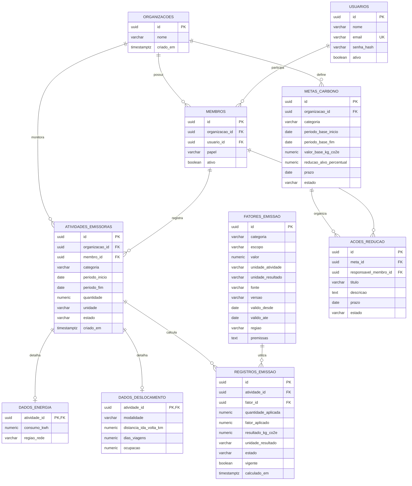

# Acorde 2.0 — Modelo Entidade–Relacionamento (DER)

> **Versão do sistema: 2.0. Status: modelo conceitual proposto.** Não representa banco implementado nem metodologia/fatores aprovados. Validar fontes, escopo, RBAC e regras de cálculo antes de criar migrações.
>
> **Stack preservada:** Java + Spring Boot, PostgreSQL, Web React e Mobile Flutter. O modelo reutiliza `organizacoes`, `usuarios` e `membros` do DER anterior; substitui tarefas/tags/impactos como núcleo por atividades emissoras, fatores e registros de emissão.

## 1. Escopo conceitual do MVP

O fluxo é: gestor registra energia na Web e colaborador registra deslocamento no Mobile → backend escolhe fator compatível e calcula → histórico e dashboard exibem dados parciais → gestor define metas e ações.

> O diagrama é conceitual. `DADOS_ENERGIA` e `DADOS_DESLOCAMENTO` detalham atributos específicos; a categoria determina qual detalhe deve existir. Confirmar se a quantidade genérica em `ATIVIDADES_EMISSORAS` é redundante antes de desenhar o esquema físico.

## 2. Entidades e cardinalidades

| Entidade | Responsabilidade e regras propostas |
|---|---|
| `organizacoes` | Escopo de isolamento de dados e papéis |
| `usuarios` | Identidade global, e-mail único e hash seguro da senha |
| `membros` | Vínculo usuário/organização e papel (`GESTOR`, `COLABORADOR`); `UNIQUE(organizacao_id, usuario_id)` |
| `atividades_emissoras` | Registro por fonte e período, pertencente a uma organização e informante; estado pode ser pendente por falta de dados/fator |
| `dados_energia` | Consumo de energia em kWh e região/rede necessária à seleção do fator |
| `dados_deslocamento` | Modalidade, distância de ida/volta, dias/viagens e ocupação quando pertinente; não requer GPS |
| `fatores_emissao` | Fator imutável/versionado com categoria, escopo, valor, unidade, fonte, versão, validade, região e premissas |
| `registros_emissao` | Uma revisão de cálculo; guarda fator/quantidade usados, resultado, estado e vigência |
| `metas_carbono` | Objetivo organizacional com base temporal, valor-base, redução-alvo e prazo |
| `acoes_reducao` | Trabalho de redução ligado a meta, com responsável, prazo e estado; não equivale a emissão evitada |

- Organização 1:N membros, atividades e metas; usuário 1:N membros.
- Membro 1:N atividades registradas e ações sob sua responsabilidade.
- Atividade 1:0..1 detalhes de energia ou deslocamento; validar coerência entre categoria e detalhe.
- Atividade 1:N revisões de cálculo; fator 1:N registros de emissão. Pode haver revisão pendente sem fator associado.
- Meta 1:N ações. O DER proposto exige meta para ação; rever se ações sem meta serão necessárias.
- Não armazenar total de dashboard como fonte independente; agregar cálculos válidos vigentes.

## 3. Integridade e metodologia

1. UUID como chaves; `TIMESTAMPTZ` para auditoria; `DATE` para períodos e prazos; `NUMERIC/DECIMAL` para quantidades, fatores e resultados.
2. Incluir `CHECK` para períodos coerentes, quantidades não negativas, reduções percentuais e domínios de estado/unidade conforme as regras aprovadas.
3. Garantir referências entre membro, atividade, fator, meta e organização. FKs simples não impedem por si sós vínculo cruzado entre organizações; avaliar chaves compostas e validação no Service.
4. O fator deve preservar fonte, versão, unidade, escopo, validade, região e premissas. Uma correção publica nova versão; não altera o histórico de cálculos.
5. Cálculo: `E = Q × FE`; aceitar somente unidade/categoria/período/região compatíveis. Guardar dados efetivamente usados.
6. Registro sem fator compatível ou sem dados suficientes fica pendente e não entra no total. Ausência não é emissão zero.
7. Uma revisão vigente por atividade entra nas agregações; as anteriores permanecem consultáveis, sem duplicar totais. Formalizar constraint de unicidade parcial em PostgreSQL.
8. Detectar dados duplicados e definir tratamento de caronas conforme método de mobilidade; evitar contabilizar duas vezes a mesma viagem.
9. Exibir emissões monitoradas com cobertura/fonte/período. Não caracterizar soma das fontes selecionadas como inventário completo.
10. Redução percentual: `(base - atual) / base × 100`, apenas se `base > 0` e os períodos forem comparáveis. Base inválida/zero significa percentual indefinido; valores negativos indicam aumento.
11. Conclusão de ação é progresso operacional e não gera automaticamente crédito, emissão evitada ou redução medida.
12. Minimizar dados pessoais; não coletar endereço ou localização precisa sem necessidade validada.

## 4. Pendências antes de migrações

- Confirmar organização piloto e fontes do MVP.
- Definir método de energia e fonte de fator por período/localização.
- Definir unidade de mobilidade (passageiro-km ou veículo-km), ocupação, dias/viagens e deduplicação.
- Definir estados e regras de transição de atividade, cálculo, meta e ação.
- Definir se fator pode faltar numa revisão pendente e como registrar o motivo.
- Formalizar RBAC, chaves compostas, retenção e exclusão de dados.
- Revisar quantidade genérica versus detalhes tipados e regra de edição/reprocessamento.
- Escolher Flyway ou Liquibase e gerar migrações só após aprovação do modelo.

## 5. Arquivos do DER

- `DER_MVP.mmd`: fonte Mermaid do modelo 2.0.
- `DER_Completo.dbml`: modelo lógico editável, incluindo expansão.
- `futuro/DER_Expansoes.md`: entidades adiadas.
- Diagramas estáticos `.svg`/`.png` devem corresponder ao modelo atual; consultar `README.md` do diretório para o estado dos artefatos.
