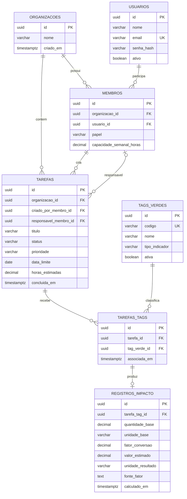
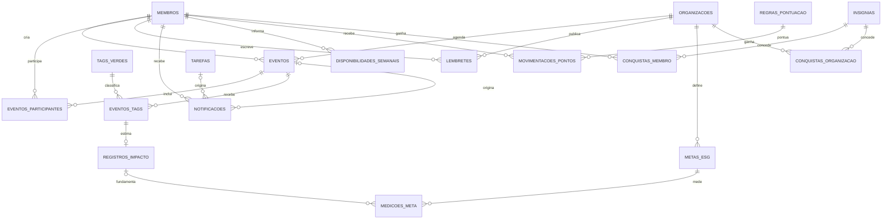

# Acorde — Diagrama Entidade–Relacionamento (DER)

> **Status:** proposta de modelo lógico, baseada nos requisitos do TCC. **Não é um banco implementado nem um modelo validado pela equipe.** Atualizar após aprovação do escopo e revisão das regras de negócio.
>
> **Stack:** Java + Spring Boot, PostgreSQL, Web React e Mobile Flutter. **Entrega acadêmica:** MVP em seis semanas, com funcionalidades complementares planejadas separadamente.

## 1. DER do MVP (7 entidades)

O núcleo viabiliza o fluxo principal: **gestor cria tarefa na Web → colaborador consulta e conclui no Mobile → sistema registra impacto ambiental estimado → dashboard Web apresenta resultados**.

**Arquivos:** `DER_MVP.svg` (vetorial), `DER_MVP.png` (imagem) e `DER_MVP.mmd` (código editável).

### Entidades do MVP

| Entidade | Para que serve | Observações |
|---|---|---|
| `organizacoes` | Agrupa os dados de uma empresa/equipe. | **Decisão proposta:** mesmo que o piloto use uma organização, preparar isolamento futuro. |
| `usuarios` | Identidades para login e autenticação. | `email` único; senha somente como hash seguro. |
| `membros` | Vínculo de um usuário à organização, com perfil. | `GESTOR` ou `COLABORADOR`; `UNIQUE(organizacao_id, usuario_id)`. |
| `tarefas` | Atividades com responsável, prazo, status e horas estimadas. | Responsável opcional; criador obrigatório; checar pertencimento à organização. |
| `tags_verdes` | Catálogo de ações sustentáveis. | Ex.: `DIGITALIZACAO`; não implica comprovação de impacto. |
| `tarefas_tags` | Relação N:N entre tarefas e tags. | `UNIQUE(tarefa_id, tag_verde_id)`. |
| `registros_impacto` | Guarda **estimativas**, unidades, premissas e fator usado. | No MVP cada vínculo tarefa/tag admite 0 ou 1 estimativa. |

### Cardinalidades importantes

- `organizacoes` **1:N** `membros`; `usuarios` **1:N** `membros` — um usuário pode pertencer a mais de uma organização, mas um vínculo de membro pertence a uma única organização.
- `organizacoes` **1:N** `tarefas` — toda tarefa pertence a uma organização.
- `membros` **1:N** `tarefas` como **criador**; **0:N** como **responsável** — uma tarefa pode começar sem responsável, mas sempre tem um criador.
- `tarefas` **N:N** `tags_verdes`, via `tarefas_tags`.
- `tarefas_tags` **1:0..1** `registros_impacto` — vínculo pode existir sem estimativa; uma estimativa depende de um vínculo válido.

## 2. Entidades para as expansões

As tabelas abaixo preservam a **visão completa RF01–RF11**, mas **não devem ser criadas apenas para preencher o escopo**. Desenvolvê-las quando o respectivo módulo entrar na sprint.

| Módulo | Entidades futuras | Requisitos |
|---|---|---|
| Calendário/aprovação | `eventos`, `eventos_participantes`, `eventos_tags` | RF01, RF04, RF06 |
| Mural e alertas | `lembretes`, `notificacoes` | RF02, RF03 |
| Metas ESG | `metas_esg`, `medicoes_meta` | RF07 |
| Sobrecarga | `disponibilidades_semanais` | RF09 |
| Eco-Score | `regras_pontuacao`, `movimentacoes_pontos`, `insignias`, `conquistas_membro`, `conquistas_organizacao` | RF08 |
| Dashboard | **sem tabela própria**: consultas e agregações das anteriores | RF10 |
| Anti-duplicidade | **sem tabela própria no MVP**: consulta textual na criação | RF05 |

### DER complementar: relações previstas

> **Nota:** o segundo diagrama enfatiza relações adicionais, usando algumas entidades do MVP como referência. O modelo físico completo e seus campos estão no arquivo `DER_Completo.dbml`.

## 3. Convenções e decisões técnicas

1. **Chaves primárias:** UUID; em PostgreSQL, `gen_random_uuid()` é uma alternativa.
2. **Data/hora:** `TIMESTAMPTZ` para eventos auditáveis; `DATE` para prazo de tarefas que não tenha horário.
3. **Autorização:** o papel fica em `membros`, e não diretamente em `usuarios`, permitindo papéis diferentes por organização. No backend, conferir a organização do usuário em toda leitura/mutação.
4. **Integridade por organização:** além de verificar no Spring Security/Service, considerar FKs compostas `(organizacao_id, membro_id)` nas tarefas, eventos e demais tabelas; a referência simples de `membro_id` **não impede sozinha** relacionamentos entre empresas diferentes.
5. **Senhas:** salvar hash (BCrypt/Argon2id), nunca senha em texto puro ou criptografia reversível.
6. **Status/prioridade/papel:** documentar valores permitidos e adicionar `CHECK` no PostgreSQL ou enum conforme decisões do backend.
7. **Impacto ESG:** não calcular CO₂ ou folhas poupadas sem valor de entrada, fonte e fatores explicáveis. `valor_estimado = quantidade_base × fator_conversao` apenas quando a métrica escolhida seguir esse modelo.
8. **Eventos futuros:** para tags em reuniões, introduzir `eventos_tags` e `evento_tag_id` opcional em `registros_impacto`, com `CHECK` exigindo **exatamente um** entre `tarefa_tag_id` e `evento_tag_id`.
9. **Eco-Score e indicadores:** calcular a partir de registros, sem armazenar totais redundantes em `usuarios` ou `membros` no início.
10. **LGPD:** evitar CPF e outros dados pessoais sem necessidade do problema; aplicar princípios de minimização e proteção.

## 4. Decisões ainda pendentes

- [ ] O piloto é **uma empresa só**? Recomendação: manter `organizacoes`/`membros` desde o começo, mas simplificar a interface.
- [ ] Quem pode atribuir uma tarefa, alterar o responsável, editar e excluir?
- [ ] Quais estados e transições de tarefa serão usados? Uma tarefa pode ter vários responsáveis?
- [ ] Prazo terá somente data ou também hora? Como tratar fusos horários?
- [ ] Quais tags sustentáveis entram no MVP? Qual evidência é necessária para contabilizar impacto?
- [ ] Como medir estimativa de papel evitado e registrar fonte/fator sem criar valores fictícios?
- [ ] Como definir a janela de carga horária, férias e ausência (`U = He/Hc × 100`)?
- [ ] Qual relacionamento entre metas, indicadores e medidas manuais será aprovado?

## 5. Para usar no GitHub e no desenvolvimento

- Copie este documento para `docs/modelagem/DER.md`.
- A visualização Mermaid renderiza direto no GitHub.
- Use `DER_Completo.dbml` no [dbdiagram.io](https://dbdiagram.io/) para editar visualmente e exportar modelos.
- Valide o DER antes de gerar migrações com **Flyway** ou **Liquibase** e implementar entidades JPA.
