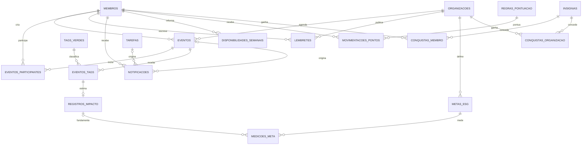

# Modelo de dados para expansões

Este material guarda propostas além do MVP. Não implementar essas entidades até que os módulos sejam priorizados pela equipe.

| Módulo | Entidades previstas | Requisitos |
| --- | --- | --- |
| Calendário e aprovações | `eventos`, `eventos_participantes`, `eventos_tags` | RF01, RF04, RF06 |
| Mural e alertas | `lembretes`, `notificacoes` | RF02, RF03 |
| Metas ESG | `metas_esg`, `medicoes_meta` | RF07 |
| Carga de trabalho | `disponibilidades_semanais` | RF09 |
| Eco-Score | `regras_pontuacao`, `movimentacoes_pontos`, `insignias`, `conquistas_membro`, `conquistas_organizacao` | RF08 |
| Dashboard | Consultas e agregações, sem tabela própria | RF10 |
| Anti-duplicidade | Consulta na criação, sem tabela própria prevista | RF05 |

O arquivo [`DER_Completo.dbml`](DER_Completo.dbml) contém o modelo lógico detalhado. Os diagramas auxiliares em `.mmd`, `.svg` e `.png` representam os módulos futuros.

Antes de priorizar uma expansão, definir seus critérios, relacionamentos com as entidades do MVP e regras de autorização. O modelo permanece uma proposta, não um esquema implementado.
