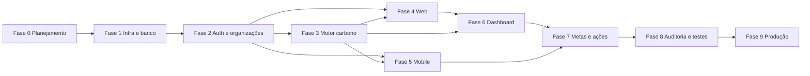

# Plano de implementação — Acorde 2.0

**Fase atual:** 08 — Auditoria e integração (fases 05–07 implementadas; validações manuais/produção ainda pendentes)  
**Versão:** Acorde 2.0  
**Estado do repositório:** base técnica, auth, motor V3, clientes Mobile/Web, dashboard e metas/ações implementados; auditoria final em andamento  
**Última revisão:** 24 de novembro de 2026

## Objetivo

Transformar o escopo documentado em entregas incrementais e rastreáveis para monitorar fontes selecionadas de pegada de carbono operacional e apoiar ações de redução. Preservar stack, arquitetura, identidade visual e limites do MVP já documentados. Este plano não aprova decisões registradas como pendentes.

## Estado e referência

O Git permanece na branch `main`. Alterações preexistentes em `README.md`, `docs/decisoes.md` e `docs/prototipos/README.md` foram preservadas. A base técnica e a implementação desta fase estão em `backend/`, `frontend/` e `mobile/`; arquivos desta fase ainda estão no working tree.

Documentos normativos: [`escopo-mvp.md`](escopo-mvp.md), [`requisitos-funcionais.md`](../requisitos/requisitos-funcionais.md), [`requisitos-nao-funcionais.md`](../requisitos/requisitos-nao-funcionais.md), [`arquitetura.md`](../arquitetura/arquitetura.md), [`DER_Acorde.md`](../der/DER_Acorde.md), [`decisoes.md`](../decisoes.md), [`plano-testes.md`](../testes/plano-testes.md) e [guia da marca](../../assets/branding/Acorde_Brand_Kit/documentacao/GUIA_DA_MARCA.md).

## Decisões estabelecidas a preservar

- Produto: monitoramento de fontes selecionadas de emissões operacionais e organização de ações de redução; não declarar inventário completo.
- MVP proposto: energia elétrica e deslocamento casa–trabalho; fatores e cálculos rastreáveis; histórico/dashboard parcial; metas e ações.
- Stack: React + TypeScript + Vite; Flutter; Java + Spring Boot; API REST HTTP/JSON; PostgreSQL; Spring Security + JWT.
- Arquitetura: monólito modular, camadas e referência MVC; módulos por domínio com camadas internas.
- Marca: Brand Kit oficial Acorde, logotipos, tokens, paleta e tipografia existentes.
- Qualidade: RNF01–RNF06; autenticação, autorização no backend, isolamento organizacional, acessibilidade, Green IT, segurança e LGPD.
- Rastreabilidade: RF-v2-01–RF-v2-09 coexistem com a baseline RF01–RF11; não apagar nem renumerar a baseline.

## Inconsistências, dependências e bloqueios

| ID | Achado/pendência | Efeito | Tratamento |
|---|---|---|---|
| B-01 / P-001 | Escopo acadêmico 2.0 ainda carece de validação formal e relação definitiva com requisitos originais | Não declarar retirada acadêmica como aprovada | Registrar aprovação/limites em `docs/decisoes.md` |
| B-02 / P-002 | Organização piloto, problema observado e autorização de dados pendentes | Critérios de aceite contextualizados | Completar validação de campo sem dados pessoais desnecessários |
| B-03 / P-003 | Nenhuma fonte/fator real aprovada; método de energia (location/market), fatores nacionais e validação acadêmica pendentes. D-011 mapeia provisoriamente energia a escopo 2 e deslocamento a escopo 3 | Bloqueia estimativas de produto com dado real | Pesquisar/validar fontes; manter fixtures sintéticas apenas nos testes identificados |
| B-04 / D-009 | Registro de mobilidade usa passageiro-km = ida e volta × dias; reenvio com mesma chave é bloqueado. Duplicidade intencional, viagens semelhantes e caronas entre pessoas não são inferidas | Não deduplica submissões com chaves diferentes | Preservar pendência; revisar regra acadêmica sem dividir por ocupação quando fator for passageiro-km |
| B-05 / P-004 | RBAC de auth/organizações foi formalizado em D-005; regras de negócio e estados continuam pendentes | Bloqueia endpoints de domínio futuros | Definir matriz e estados antes das fases 3/6/7 |
| B-06 / P-005 | Flyway e contratos de auth/org definidos; ambiente de deploy e contratos REST de negócio pendentes | Bloqueia deploy e API de domínio | Registrar escolhas antes das fases de negócio/produção |
| B-07 / P-006/007 | V3 persiste fatores, atividades tipadas, snapshots e índice único de revisão vigente; documentação editável atualizada, SVG/PNG permanecem conceituais | Risco de tratar ilustração conceitual como esquema físico | Manter migrations como autoridade física e regenerar artefatos estáticos quando a equipe revisar o DER |
| B-08 / P-008 | Protótipos citam Figma e Google Stitch; origem e validade não confirmadas | Não tratar protótipos antigos como aprovados | Confirmar com equipe e validar fluxos Acorde 2.0 |
| B-09 | Build e stack Compose de produção foram validados em projeto isolado, com segredo sintético e volume próprio; serviços de desenvolvimento e volumes existentes foram preservados | Deploy externo, backup/restauração e operação com segredos reais seguem sem validação | Repetir checks no ambiente escolhido e ensaiar recuperação sem tocar em dados existentes |

## Propostas técnicas reversíveis — aguardam decisão

Estas propostas não alteram decisões aprovadas; registrar aceite/rejeição em `docs/decisoes.md` antes de fixar o esquema ou contratos.

| Proposta | Razão | Gate |
|---|---|---|
| Organizar backend por domínio com camadas internas | Implementa o monólito modular já estabelecido | Confirmar árvore inicial na Fase 1 |
| Manter versões de fatores imutáveis e cálculos como revisões auditáveis | Reproduzir resultados históricos e impedir reescrita silenciosa | Definir versionamento e regra de uma revisão vigente antes do motor |
| Usar migrations explícitas (Flyway ou Liquibase) | Evolução rastreável do PostgreSQL | Escolher ferramenta na Fase 1, após revisão do DER |
| Separar detalhes tipados por fonte, se aprovados | Validar energia/mobilidade sem campos genéricos ambíguos | Resolver duplicidade no DER antes da Fase 1 banco |
| Agregar dashboards a partir de registros válidos vigentes | Evitar totais duplicados/desatualizados | Definir comparabilidade/cobertura antes do dashboard |

## Plano por fases

Cada item recebe estado `[ ] planejado`, `[x] concluído com evidência` ou `[!] bloqueado`, com link para issue/PR/evidência. Não marcar concluído apenas por documentação ou intenção.

### Fase 0 — Planejamento (base documental preparada; pendências de produto abertas)

**Requisitos relacionados:** RF-v2-01–09, RNF01–06 como base de rastreabilidade.

- [x] Consolidar escopo e contexto 2.0 a partir dos documentos existentes.
- [x] Preservar baseline RF01–RF11 e decisões de stack/arquitetura/marca.
- [x] Registrar achados do Git e alterações locais a preservar.
- [x] Criar instruções permanentes em `AGENTS.md`.
- [x] Criar este plano com dependências, gates e critérios.
- [ ] Validar escopo acadêmico, organização piloto e fontes/métodos.
- [ ] Resolver pendências P-004–P-008 e registrar decisões propostas aceitas/rejeitadas.

**Aceite da fase:** inventário de decisões e bloqueios rastreável; plano cobre fases 1–9; AGENTS contém instruções permanentes. Pendências de validação acadêmica/piloto seguem registradas.

### Fase 1 — Infraestrutura e banco de dados (base implementada; serviço local verificado)

**Requisitos:** base técnica para RF-v2-01–09; RNF01, RNF05, RNF06. **Dependências:** Fase 0 pode continuar em paralelo. Revisão do DER e escolha de migration tool são pré-requisitos de esquema de domínio.

- [x] Criar `backend/`, `frontend/`, `mobile/` com Java 21/Spring Boot 3.5, React/TypeScript/Vite 8 e Flutter stable; monólito modular reservado por domínio.
- [x] Documentar setup local, comandos e configuração sem credenciais reais.
- [x] Preparar PostgreSQL 17 via Compose e conexão por variáveis de ambiente.
- [x] Escolher Flyway e criar migration inicial sem esquema de domínio; nenhuma regra do DER ainda é suficientemente aprovada para criar tabelas.
- [x] Definir health check HTTP e Actuator sem dados de domínio.
- [x] Importar ativos oficiais de marca para Web e Mobile sem redesenho.
- [x] Compilar frontend e backend; executar `flutter analyze` sem erros (evidências abaixo).
- [x] Iniciar PostgreSQL 18.6 isolado, aplicar migrations Flyway e iniciar API conectada; ver evidências da Fase 2.
- [x] Validar health check e rotas da API em execução conectada ao PostgreSQL.
- [x] Validar configuração Compose e verificar PostgreSQL local `acorde-postgres` em estado `running/healthy`; sem reiniciar serviço/volume existente.

**Aceite:** clone/setup reproduzível; cada base inicia com comandos documentados; conexão PostgreSQL demonstrável; migration inicial executa em banco limpo; nenhum segredo commitado; sem lógica de produto nesta fase.

**Evidências (2026-11-24):** migrations Flyway e API integrada foram verificadas diretamente em PostgreSQL 18.6 isolado; configuração Compose validada e PostgreSQL 17 local observado `running/healthy`; `frontend/npm run build`, Maven tests, `flutter analyze` e widget test passam. Nenhum volume existente foi reiniciado ou removido. Flyway permanece escolhido por D-004. As tabelas de carbono são de V3 e as de metas/ações são V4, registradas nas fases correspondentes.

### Fase 2 — Autenticação e organizações

**Requisitos:** RF-v2-01, RF-v2-02; RNF06. **Dependências:** Fase 1; RBAC e integridade organizacional aprovados.

- [x] Modelar usuário, organização, membro e sessão revogável; migration `V2` alinhada ao DER.
- [x] Implementar login e hash BCrypt; JWT HS256 com expiração de 15 minutos e logout revogável.
- [x] Formalizar/aplicar RBAC para auth e gestão de membros; proteger último gestor e invalidar sessão quando papel muda.
- [x] Derivar organização do vínculo persistido; filtrar consultas/alterações por organização autenticada e retornar 404 em tentativas cross-organization.
- [x] Implementar contratos REST e erros padronizados em `docs/api/autenticacao-organizacoes.md`.
- [x] Integrar login/logout/perfil e consulta de membros nos clientes Web e Mobile; token fica em memória.
- [x] Disponibilizar perfil `local-demo` não destrutivo e fixtures de teste isoladas em duas organizações.
- [x] Executar T-01–T-04 e cenários de token inválido/expirado, ausência de bearer, logout/revogação e troca de papel em PostgreSQL 18.6.

**Aceite:** atendido em PostgreSQL 18.6 isolado; veja [`../testes/evidencias-fase-02.md`](../testes/evidencias-fase-02.md). RBAC de módulos de negócio permanece gate das respectivas fases.

### Fase 3 — Motor de cálculo de carbono

**Requisitos:** RF-v2-03, 04 e 05; RNF06. **Dependências:** Fases 1–2; método de deslocamento D-009; curadoria de fatores D-010; mapeamento provisório de escopo D-011.

- [x] Persistir fator versionado e consultar catálogo somente leitura; sem fatores reais de produto.
- [x] Registrar energia e deslocamento, incluindo região e detalhes tipados.
- [x] Validar categoria, escopo provisório, unidade, região, unidade de resultado e validade cobrindo todo o período; ambiguidade mantém pendente.
- [x] Calcular `E = Q × FE` no backend com `BigDecimal`, escala explícita e snapshot de entradas/fator.
- [x] Manter dados/fatores ausentes ou incompatíveis pendentes sem valor zero.
- [x] Revisar atividade e reprocessar explicitamente; preservar revisões e limitar a uma revisão válida vigente.
- [x] Proteger reenvios pela chave idempotente; não inferir duplicidade entre pessoas, chaves distintas ou caronas.
- [x] Corrigir FK composta V3, precisão de resultado e estado de revisões substituídas.
- [x] Executar 20 testes de integração em PostgreSQL 17 temporário, com migrations Flyway e Hibernate `validate`.
- [!] Seleção/publicação de fatores reais, método elétrico location/market e validação acadêmica permanecem bloqueios P-003; escopo de RBAC de negócio permanece em P-004.

**Aceite técnico:** evidenciado em [`../testes/evidencias-fase-03.md`](../testes/evidencias-fase-03.md). As pendências P-003/P-004 não são tratadas como aprovadas nem há fatores reais no banco do projeto.

### Fase 4 — Frontend Web (implementada; validação funcional automatizada local)

**Requisitos:** RF-v2-01, 03, 04, 06, 07, 08 e 09 conforme fluxos Web; RNF01–05. **Dependências:** Fases 1–2 e contratos de API; registro/cálculo integra conforme Fase 3.

- [x] Aplicar tokens oficiais, responsividade, tema claro/escuro e controles acessíveis por teclado.
- [x] Implementar login do gestor e do colaborador, expiração da sessão, logout e seleção de organização.
- [x] Implementar navegação principal, resumo informativo e telas de energia/registros.
- [x] Conectar cadastro e histórico aos endpoints de energia e atividades. Conforme D-014, o colaborador também registra o próprio deslocamento na Web e consulta seu histórico pessoal.
- [x] Exibir estados pendentes/erro/vazio e justificativa devolvida pela API; sem fabricar resultados.
- [x] Construir e servir a Web por nginx no stack Docker junto à API/PostgreSQL isolados; smoke HTTP da página e do proxy `/api/health` retornaram 200.
- [x] Inspecionar a tela de login em screenshot headless desktop; corrigir overflow horizontal detectado em viewport móvel.
- [!] Completar fluxos interativos da Web em navegador real e revisar acessibilidade manualmente; a automação de screenshot pós-correção foi bloqueada pelo ambiente.
- [x] Integrar dashboard e gestão de metas/ações às APIs das Fases 6–7.

**Aceite parcial:** TypeScript/lint, Docker build e smoke HTTP passam; APIs de atividade/dashboard/metas/ações têm testes PostgreSQL e fluxo sintético ponta a ponta. Interação completa por navegador e auditoria manual de acessibilidade ainda precisam de evidência.

### Fase 5 — Aplicativo Mobile

**Requisitos:** RF-v2-01, 03 e 08; RNF01–06. **Dependências:** Fase 1–2 e contratos API; regras de deslocamento aprovadas para registro.

- [x] Inicializar Flutter, documentar versão local e manter alvos gerados para plataformas suportadas.
- [x] Integrar login, seleção de organização, expiração, logout e chamadas autenticadas.
- [x] Implementar registro de deslocamento casa–trabalho com unidade passageiro-km, região e período; sem GPS/endereço.
- [x] Implementar histórico autorizado e consulta/avanço das ações atribuídas via API.
- [x] Reutilizar logotipo/tokens Acorde e informar estado pendente/erro/vazio.
- [x] Executar `flutter analyze`, `flutter test` e build local de APK Android; configurar assinatura de distribuição por variáveis externas sem versionar chaves.
- [!] Executar emulador/dispositivo Android/iOS e validar fluxos visuais; este host detectou Chrome/Windows, sem emulador, e o APK atual usa assinatura debug para demonstração.

**Aceite parcial:** analyze, widget test e build APK passaram. Persistência móvel em dispositivo/emulador e assinatura oficial ainda dependem do ambiente e das chaves da equipe.

### Fase 6 — Dashboard e indicadores

**Requisitos:** RF-v2-06 e 09; RNF01–05. **Dependências:** Fases 3–4; critério de cobertura e comparabilidade definidos.

- [x] Agregar somente atividades vigentes válidas por fonte/período/organização; pendências ficam contadas separadamente.
- [x] Mostrar cobertura parcial e contagem de registros pendentes sem sugerir inventário completo.
- [x] Exibir composição por fonte e evolução por intervalos informados, sem redistribuir dados por mês.
- [!] Comparações ambientais não são calculadas enquanto metodologia/cobertura comparáveis não forem validadas (P-003).
- [x] Separar valores emitidos de andamento operacional das ações; nenhum cenário/evitada foi inventado.

**Aceite parcial:** endpoint é coberto por integração PostgreSQL (válido, pendente, filtro de período, isolamento e RBAC); Web build/lint passam. Teste navegador, gráficos e medições RNF ainda pendentes.

### Fase 7 — Metas e ações

**Requisitos:** RF-v2-07 e 08; RNF06. **Dependências:** Fases 2, 4 e 6 para progresso baseado em dados comparáveis; matriz RBAC e transições aprovadas.

- [x] Persistir/criar/listar metas por organização com fonte, intervalo-base, valor, alvo, prazo e estado inicial.
- [x] Criar ações vinculadas a meta com responsável, prazo, descrição e estado.
- [x] Aplicar permissões no servidor. O gestor gerencia ações da organização e o colaborador consulta e avança suas ações atribuídas na Web ou no Mobile (D-012 e D-015).
- [x] Exibir operação e manter conclusão de ação separada de emissões.
- [!] Progresso ambiental não é calculado sem cobertura/períodos comparáveis validados (P-003).

**Aceite parcial:** teste PostgreSQL cobre criação, atribuição, lista do colaborador, acesso cruzado, transição e base zero; a revisão/aprovação da proposta D-012 ainda está pendente.

### Fase 8 — Auditoria, integração e testes

**Requisitos:** RF-v2-01–09 e RNF01–06. **Dependências:** integração das fases anteriores; iniciar testes de regressão durante cada fase.

- [x] Auditar rastro atividade → fator → cálculo → dashboard por snapshots e filtros de revisão vigente.
- [x] Revisar escopo organizacional/papéis contra os testes de integração; suíte cobre isolamento cross-org, dashboard, ações e transições. O script de teste agora desativa `DEBUG` durante a suíte e trata avisos nativos do Maven sem falso erro.
- [x] Executar 22 testes PostgreSQL, Web lint/build, Flutter analyze/widget test e APK Android; Docker build e stack isolado aplicam migrations V1–V4 e passam smoke HTTP.
- [x] Validar reenvio idempotente, fatores ausentes como pendentes, ação via API e persistência de ações após restart isolado da API.
- [!] Validar manualmente interação e acessibilidade em navegador/dispositivos e medir os RNFs; screenshot pós-correção móvel e alvos iOS ainda sem evidência.
- [ ] Medir desempenho em condições documentadas.
- [x] Validar repetição com a mesma chave idempotente e persistência após reiniciar a API isolada.
- [ ] Validar falhas de rede e recuperação do cliente Mobile sem duplicação.
- [ ] Atualizar DER, contratos, setup, evidências e documentação da versão.

**Aceite:** critérios aplicáveis do plano de testes executados e evidenciados; RNFs medidos ou limitações declaradas; dados e fatores demonstrativos rotulados; modelo e docs refletem o software. Nenhuma evidência presumida.

### Fase 9 — Produção e implantação

**Requisitos:** RNF01, RNF04, RNF05, RNF06; escopo de implantação ainda pendente. **Dependências:** Fase 8; decisões de hospedagem/ambientes, domínio, backup, monitoramento e aprovação necessárias.

- [!] Provedor/região/domínio/custo ainda precisam de decisão; foi preparada topologia Docker Compose sem escolher fornecedor.
- [!] Segredos são externos e PostgreSQL/API ficam em rede privada no Compose; TLS, retenção e backup efetivo dependem do ambiente escolhido.
- [x] Adicionar pipeline CI para PostgreSQL + migrations/testes, lint/build Web e analyze/test Flutter.
- [x] Construir imagens Docker de API/Web e executar stack de produção em projeto isolado com credenciais sintéticas; API e PostgreSQL sem porta publicada, Web somente em loopback.
- [!] Assinatura oficial Android depende de keystore/segredos fornecidos pela equipe; APK local usa chave debug.
- [!] Fazer revisão de segurança, privacidade, acessibilidade e desempenho pré-release.
- [x] Documentar rollback/recuperação e limitações em `docs/implantacao-preparacao.md`; backup/restauração ainda precisam ser ensaiados no ambiente aprovado.
- [ ] Executar implantação externa somente com autorização explícita.

**Aceite:** aprovação do responsável; segredos fora do Git; backup/restauração verificados; monitoramento/rollback documentados; smoke checks evidenciados; sem publicar ou alterar infraestrutura externa sem autorização.

**Aceite parcial:** imagens e stack foram testados localmente com segredos/volume isolados. Workflow hospedado, TLS, backup/restauração, assinatura oficial Mobile e ambiente externo continuam sem validação/aprovação; nenhum deploy foi feito.

## Fluxo e validação entre fases

Trilhas Web e Mobile podem avançar independentemente depois de contratos e auth estáveis. A Fase 8 recebe evidências incrementais; a sequência não exige esperar o fim do produto para validar cada fatia.

## Rotina de progresso

- [ ] Toda tarefa vinculada a issue, requisito, responsável e critério de aceite.
- [ ] Marcar `[x]` somente com PR/commit e evidência de validação executada.
- [ ] Registrar bloqueio como `[!]`, causa, impacto, responsável e próximo passo; continuar trabalho independente.
- [ ] Atualizar decisões, plano, testes e relatório de sprint ao concluir cada fase.
- [ ] Preservar alterações locais/de outros integrantes; não fazer push, merge ou deploy externo sem autorização.

## Gate imediato

A revisão visual D-013 tem validação incremental de interface com dados sintéticos no Chrome, registrada nas [evidências das Fases 05–07](../testes/evidencias-fases-05-07.md#revis%C3%A3o-visual-em-26-de-novembro-de-2026). Os gates de acessibilidade e de validação em Android/iOS permanecem abertos.

Fases 1–7 têm implementação; a suíte PostgreSQL passou com 22 testes, Web lint/build passou, Flutter analyze e 2 testes de widget passaram e o APK Android foi construído. Imagens Docker Web/API e stack Compose isolado passaram smoke HTTP e fluxo sintético; o teste não alterou o banco `acorde-postgres` existente. Web e Mobile têm alternância de tema escuro; a tela de login teve screenshot desktop e o overflow móvel foi corrigido no CSS, mas a captura posterior foi bloqueada e fluxos interativos/acessibilidade continuam pendentes. Android/iOS físico, RNFs, assinatura Android oficial, TLS/deploy e backup ainda requerem validação. Fatores reais/metodologia e validação acadêmica seguem P-003; D-012 continua provisória em P-004. O checklist consolidado está em [`relatorio-final-entrega.md`](../testes/relatorio-final-entrega.md).
